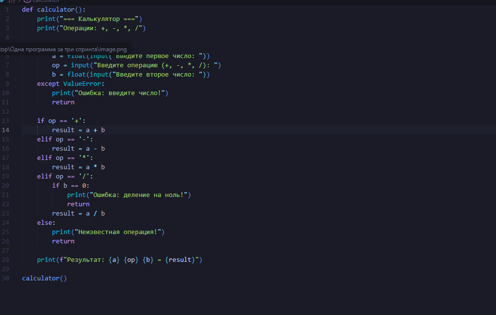

# Одна программа за три спринта

В двух предложениях опишите, для кого программа и какую задачу она решает.

## Запуск

Откройте терминал в папке проекта. Для запуска последней версии выполните `python v3.py`. Если в Windows вы запускаете Python командой `py`, выполните `py v3.py`.

- [Первая версия](v1.py) — 
 v1
- [Вторая версия](v2.py) —

- [Третья версия](v3.py) — …

## Команда

Запишите имена участников и кто чем занимался.
Белеков Нурэль- разработа, проверка и т.д.

## Спринт 1. План и первая версия

- **Цель первой версии:** вычисление базовых примеров

| Что сделать | Кто делает | Сейчас или позже | Что получилось |
| калькулятор | Нурэль | сейчас | калькулятор |
| … | … | … | … |

- **Что показали в v1:** калькулятор

**Скриншот v1.py.** Замените шаблонную картинку с одним кубиком своим скриншотом. Покажите основное действие первой версии: что ввели и что увидели.

)

## Спринт 2. Доработка после показа 

- **Что изменим и как поймём, что готово:** 

| Что проверили | Что ожидали | Что увидели |
| --- | --- | --- |
| Новая функция | … | … |
| Функция из v1 | … | … |

- **Что поправили после показа:** …
- **Что вошло в v2:** …

**Скриншот v2.py.** Замените шаблонную картинку с двумя кубиками своим скриншотом. Покажите, что добавили или исправили после замечания.

)

## Спринт 3. Запрос на изменение и выпуск

- **CR-1 (первый запрос на изменение):** кто попросил доработку и когда — …
- **Что добавить и зачем:** …
- **Как понять, что готово:** …
- **Что затронет изменение:** …
- **Что может сломаться и как это проверить:** …
- **Что согласовали и кто делает:** …

| Что проверили | Что ожидали | Что увидели |
| --- | --- | --- |
| Действие из CR-1 | … | … |
| Старая функция, которую он мог затронуть | … | … |

- **Что вошло в v3:** …
- **Как пользоваться новой функцией:** …

**Скриншот v3.py.** Замените шаблонную картинку с тремя кубиками своим скриншотом. Покажите действие из запроса CR-1 и его результат.

